# Mise en place d'un service de VoIP : cas d'Asterisk

**Projet — 2INF1521 : Réseaux Mobiles**
Licence Professionnelle, Systèmes et Réseaux Informatiques — Sciences et Technologies

**Étudiants :** AKAMA Kodjovi Jean-Hugues · TSIKPLONOU Ulrich Eugène Kékéli
**Chargé du cours :** Dr MAO
**Année universitaire :** 2024-2025

---

## Sommaire

1. [Objectif général](#objectif-général)
2. [Présentation d'Asterisk](#présentation-dastérisk)
3. [Caractéristiques principales](#caractéristiques-principales-dasterisk)
4. [Installation d'Asterisk](#installation-dastérisk)
5. [Configuration d'Asterisk](#configuration-dastérisk)
6. [Configuration de la boîte vocale](#configuration-de-la-boîte-vocale)
7. [Tests et validation](#tests-et-validation)
8. [Conclusion](#conclusion)

---

## Objectif général

La **VoIP (Voice over IP)** est une technologie qui permet de transmettre la voix sous forme de paquets de données numérisées sur des réseaux IP. Elle est notamment utilisée pour la **téléphonie sur IP (ToIP)**, afin de fournir aux entreprises et organisations une solution de communication unifiée, flexible et économique.

Ce projet consiste à déployer un serveur de téléphonie VoIP complet avec **Asterisk** : installation, configuration des comptes utilisateurs (softphones), mise en place d'un plan de numérotation et d'une messagerie vocale, puis validation par des tests d'appels réels.

## Présentation d'Astérisk

### Description

Asterisk est un logiciel **open source** qui transforme un ordinateur en autocommutateur téléphonique privé (**PABX**). Il couvre un large éventail de besoins : messagerie vocale, transfert d'appels, files d'attente, call parking, standard automatique, conférences, musique d'attente, groupement d'appels, etc.

### Caractéristiques principales d'Asterisk

| Caractéristique | Détails |
|---|---|
| **Open Source et Gratuit** | Licence GPL, communauté active contribuant à son développement |
| **Multi-protocoles** | SIP, IAX (Inter-Asterisk eXchange), H.323, MGCP — interopérabilité avec une grande variété d'équipements |
| **Fonctionnalités PBX avancées** | Appels entrants/sortants, transfert, mise en attente, messagerie vocale avec notification e-mail, files d'attente, conférences audio/vidéo |
| **Évolutivité** | Adapté aux petites comme aux grandes organisations, sans limite matérielle stricte |
| **Intégration** | Interfaçage avec des CRM (Salesforce, Zendesk…) et applications métier |
| **Routage intelligent** | Règles personnalisables (horaires, origine d'appel), IVR (serveur vocal interactif) |
| **Téléphones IP et softphones** | Compatible matériel et logiciel (applications VoIP ordinateur/mobile) |
| **Sécurité** | Chiffrement SRTP/TLS, authentification des utilisateurs et appareils |
| **Enregistrement des appels** | Pour la formation, la conformité ou le contrôle qualité |
| **Réseaux distants** | Connexion de plusieurs sites via liaisons VoIP |
| **Personnalisation** | Configuration par fichiers texte ou interface graphique (FreePBX), scripts AGI |
| **Vidéo et messagerie** | Gestion des appels vidéo, messagerie instantanée et présence |

## Installation d'Astérisk

> Prérequis : une distribution Linux (Ubuntu ou Debian) avec accès à Internet.

### 1. Récupération et décompression des paquets

Depuis `https://downloads.asterisk.org/telephony`, trois archives sont récupérées via leur lien de téléchargement :

- `asterisk-22.2.0-rc2.tar.gz` (répertoire `asterisk/`)
- `dahdi-linux-complete-current.tar.gz` (répertoire `dahdi-linux-complete/`)
- `libpri-1-current.tar.gz` (répertoire `libpri/`)

En tant que **root**, depuis `/usr/src`, chaque lien est récupéré avec `wget`, puis chaque archive est décompressée avec :

```bash
tar -xvzf <Nom_du_fichier>.tar.gz
```

<p align="center">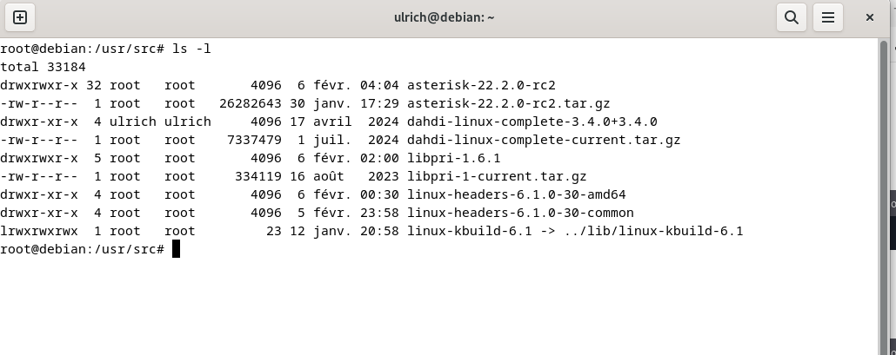<br><em>Figure 1 — Décompression des fichiers téléchargés</em></p>

### 2. Compilation et installation de DAHDI

Dans le répertoire `dahdi-linux-complete-3.4.0+3.4.0`, la commande `make` est lancée (si elle est absente : `apt install make`).

Une première erreur survient faute de headers du noyau Linux :

<p align="center">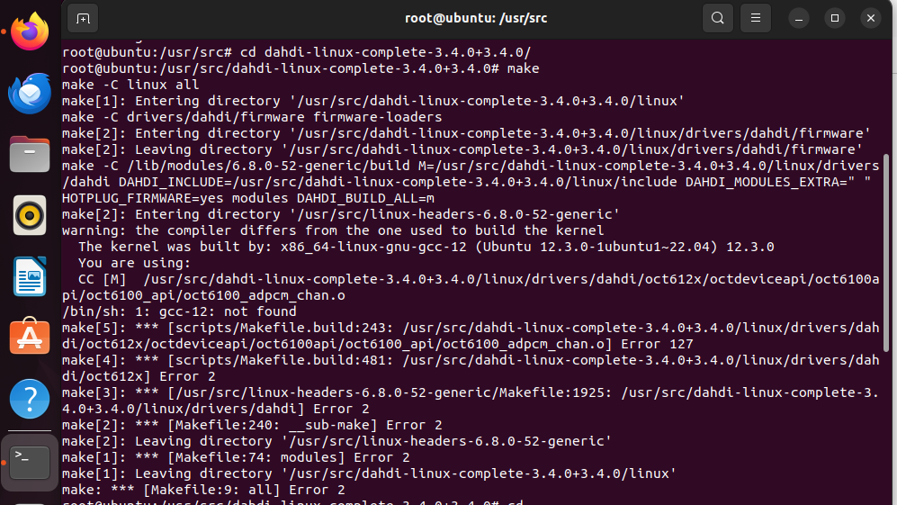<br><em>Figure 2 — Erreur d'installation : en-têtes du noyau manquants</em></p>

**Résolution :**
```bash
cd ..
apt install linux-headers-$(uname -r)
apt autoremove
```

<p align="center">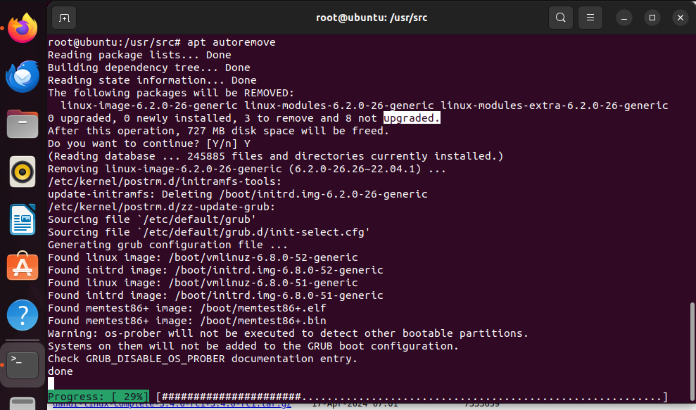<br><em>Figure 3 — Installation du noyau Linux pour la compilation</em></p>

Si l'erreur persiste, vérifier la version de `gcc` (`gcc --version`). Si elle est inférieure à 12, installer et configurer `gcc-12` :

```bash
apt install gcc-12
sudo update-alternatives --install /usr/bin/gcc gcc /usr/bin/gcc-12 100
gcc --version
```

Recompiler ensuite DAHDI :
```bash
cd dahdi-linux-complete-3.4.0+3.4.0
make
```

<p align="center">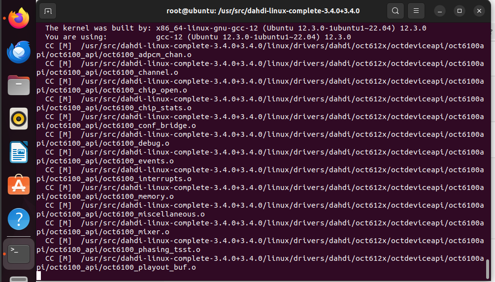<br><em>Figure 4 — Script de compilation DAHDI</em></p>

En cas de nouvelle erreur bloquant la compilation : supprimer le dossier `dahdi`, le ré-extraire, puis (hors du dossier `dahdi`) :

```bash
sudo apt-get update
sudo apt-get install --reinstall autoconf automake libtool make \
    linux-headers-$(uname -r) build-essential libncurses-dev bison flex
cd /usr/src/dahdi-linux-complete-3.4.0+3.4.0/tools
autoreconf -fvi
```

<p align="center">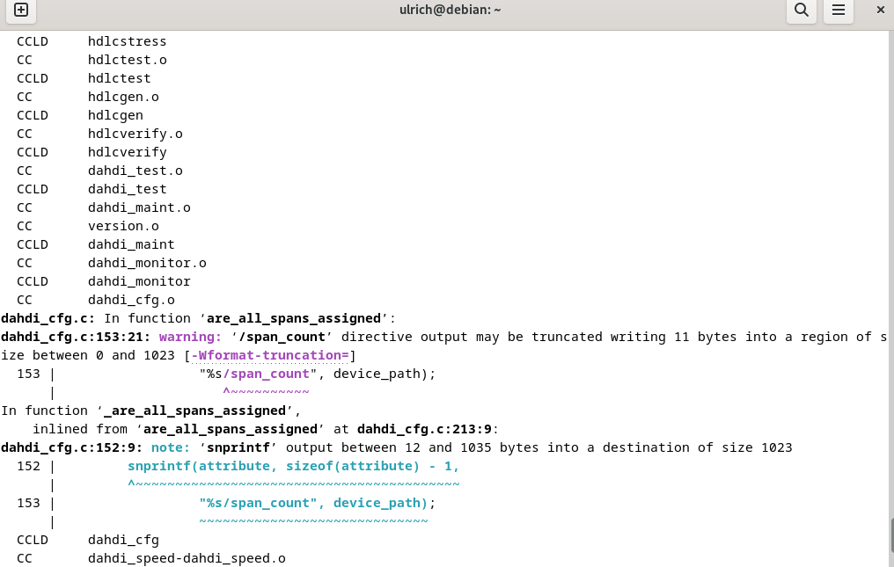<br><em>Figure 5 — Correction de la compilation</em></p>

Une fois la compilation réussie : `make install`, puis `make config`.

### 3. Compilation et installation de libpri

Depuis le répertoire `libpri-1.6.1` :

```bash
make
make install
```

<p align="center">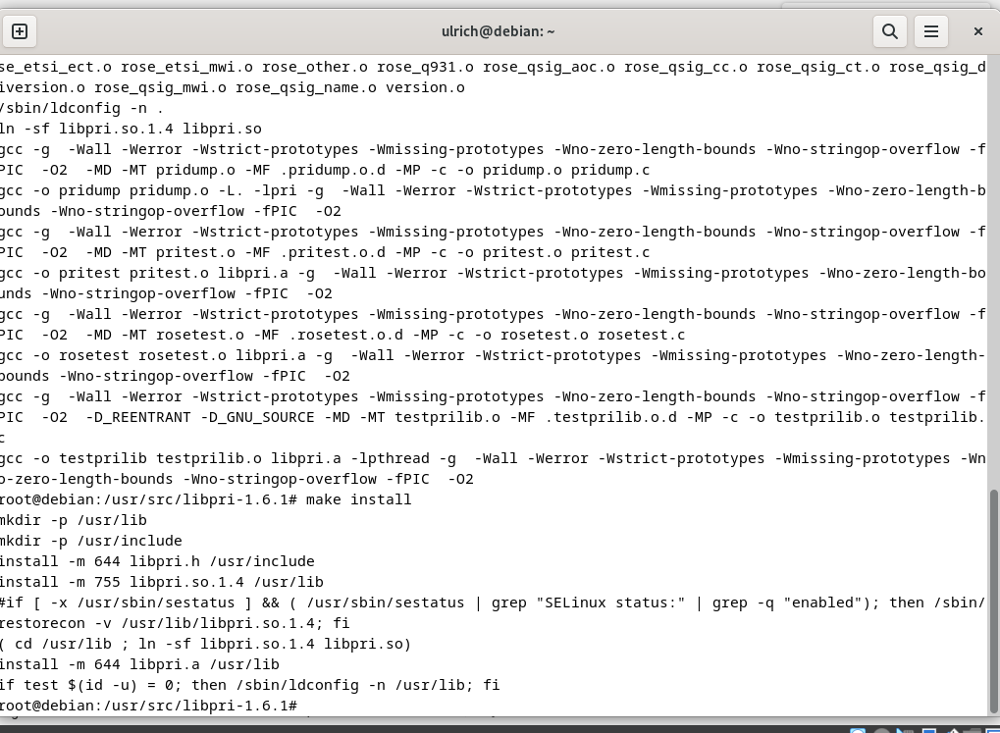<br><em>Figure 6 — Installation de libpri</em></p>

### 4. Installation des prérequis et compilation d'Asterisk

Exécuter le script `install_prereq` situé dans `asterisk-22.2.0-rc2/contrib/scripts` :

```bash
./install_prereq install
```

<p align="center">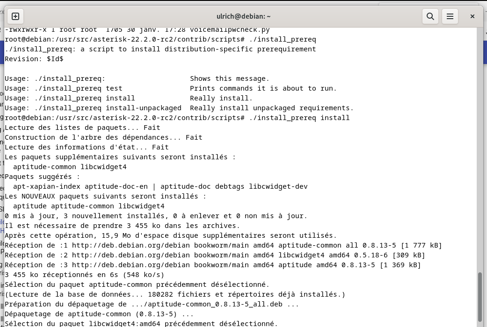<br><em>Figure 7 — Installation des prérequis</em></p>

<p align="center">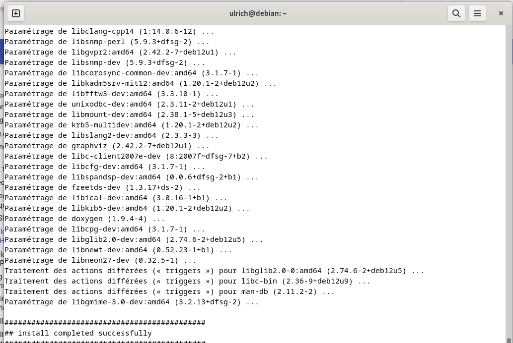<br><em>Figure 8 — Installation complète</em></p>

> En cas d'erreur, supprimer le fichier temporaire concerné :
> ```bash
> rm -f /tmp/pjproject-2.15.1.tar.bz2
> make distclean
> ./configure
> ```

<p align="center">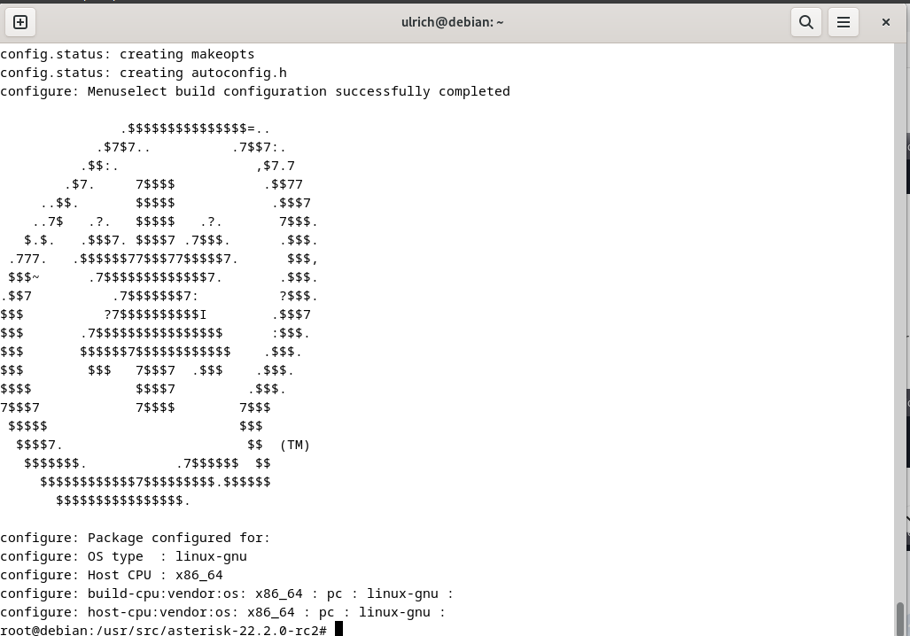<br><em>Figure 9 — Opération complète Asterisk (logo de confirmation)</em></p>

### 5. Sélection des modules (menuselect)

```bash
make menuselect
```

<p align="center">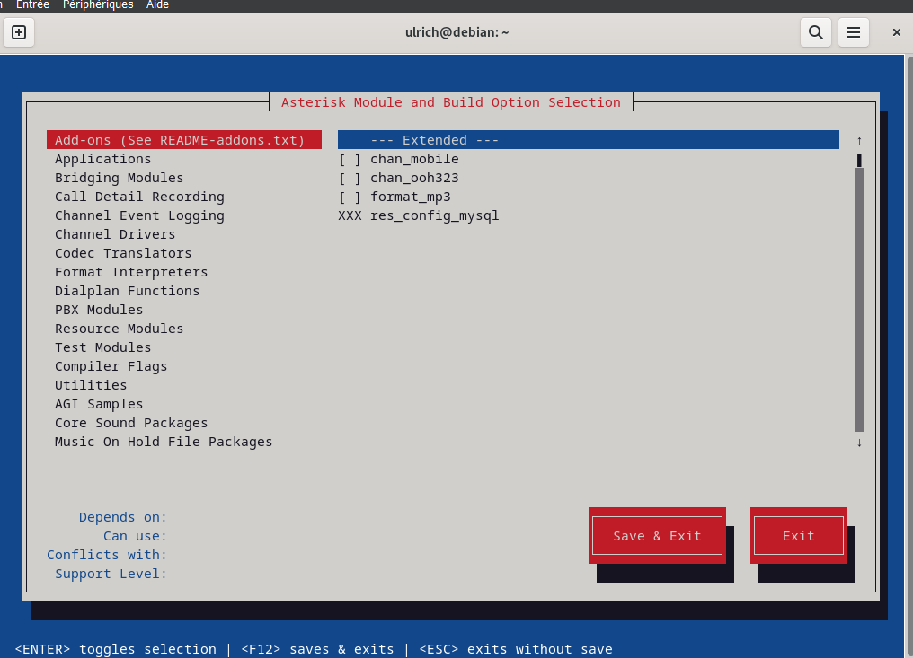<br><em>Figure 10 — Menu Asterisk (menuselect)</em></p>

Dans **Core Sound Packages** :
- Désélectionner `CORE-SOUNDS-EN-GSM`
- Sélectionner `CORE-SOUNDS-FR-ALAW` et `CORE-SOUNDS-FR-ULAW`

Puis **Save & Exit**, et finaliser l'installation :

```bash
make
make install
```

<p align="center">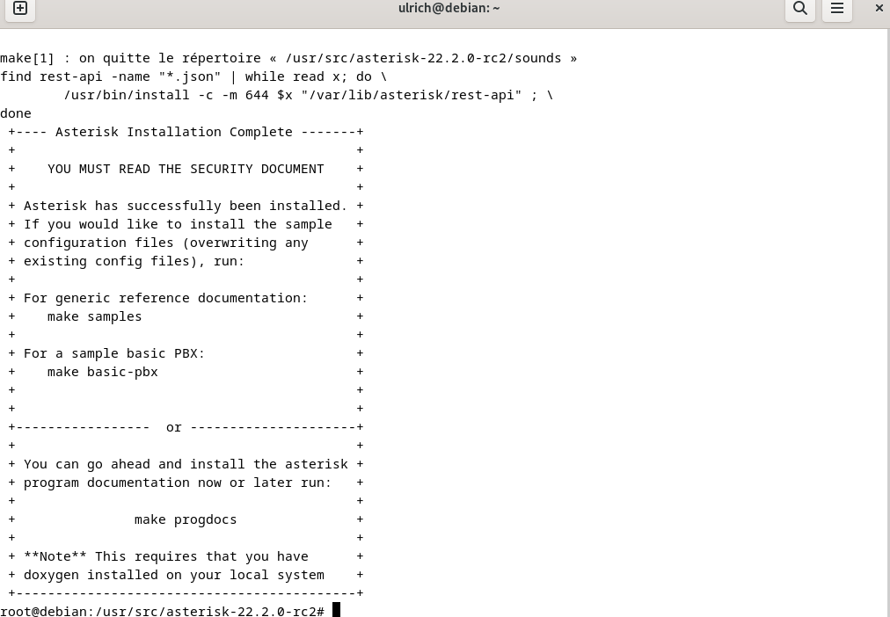<br><em>Figure 11 — Installation complète d'Asterisk</em></p>

### 6. Finalisation de l'installation

```bash
ls /etc/asterisk          # dossier vide
make samples               # génère les fichiers de configuration
ls /etc/asterisk           # fichiers générés visibles
make config                # crée les scripts de démarrage (/etc/init.d)
asterisk.logrotate.tmp     # rotation des journaux
netstat -anup               # vérifie les services actifs
service asterisk start
service asterisk status
```

## Configuration d'Astérisk

### Définir les règles et les utilisateurs

Se positionner dans `/etc/asterisk` (toujours en root) :

<p align="center">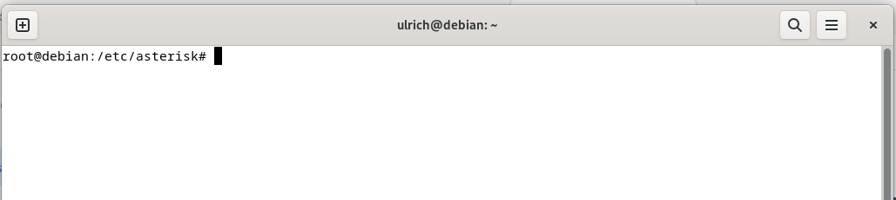<br><em>Figure 12 — Positionnement dans le répertoire de configuration</em></p>

Sauvegarde du répertoire de configuration avant modification :

```bash
cp -R /etc/asterisk/ /home/<utilisateur>/asterisk1
```

<p align="center">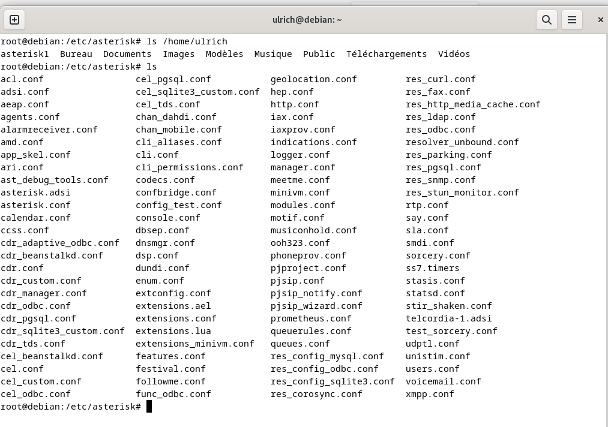<br><em>Figure 13 — Vérification du répertoire de sauvegarde</em></p>

### Manipulation

Deux fichiers sont au cœur de la configuration :

| Fichier | Rôle |
|---|---|
| `pjsip.conf` (renommé depuis `sip.conf`) | Déclaration des softphones : IP, secret, numéro |
| `extensions.conf` | Plan de numérotation : ce qui se passe quand un numéro est composé |

Avant édition, les fichiers originaux sont renommés (ou recréés si absents) :

```bash
mv pjsip.conf sip.conf.origine
mv extensions.conf extensions.conf.origine
nano pjsip.conf
nano extensions.conf
```

Un premier test de démarrage du service permet de contrôler la configuration :

```bash
service asterisk status
service asterisk stop
service asterisk start
```

<p align="center">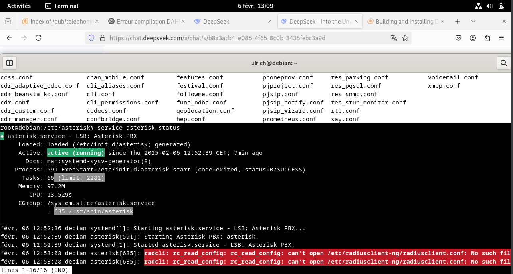<br><em>Figure 14 — Vérification du service Asterisk</em></p>

Une erreur signalant le paquet manquant **radiusclient-ng** est résolue par l'installation de `radcli` :

```bash
wget https://github.com/radcli/radcli/archive/refs/tags/1.3.1.tar.gz
tar -xvzf 1.3.1.tar.gz
cd radcli-1.3.1
./autogen.sh
./configure
make
make install
cp /etc/radcli/ /home/<utilisateur>/radcli1
mv /etc/radcli /etc/radiusclient-ng
service asterisk stop
service asterisk restart
service asterisk status
```

<p align="center">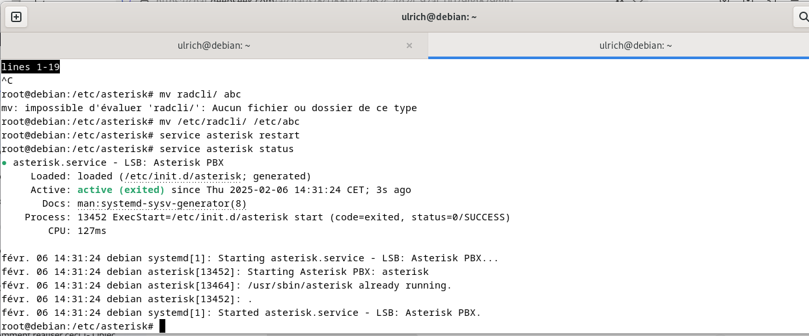<br><em>Figure 15 — Installation du paquet radius et vérification</em></p>

#### Configuration de `pjsip.conf`

**Section `transport` :**
| Paramètre | Valeur | Rôle |
|---|---|---|
| `protocol` | `udp` | Protocole de transport utilisé |
| `bind` | `0.0.0.0` | Écoute sur toutes les interfaces réseau |

**Section `endpoint` :**
| Paramètre | Valeur | Rôle |
|---|---|---|
| `context` | `from-internal` | Lien entre l'utilisateur et son numéro via `extensions.conf` |
| `disallow` | `all` | Aucun codec autorisé par défaut |
| `allow` | `ulaw` | Codec `ulaw` autorisé |

<p align="center">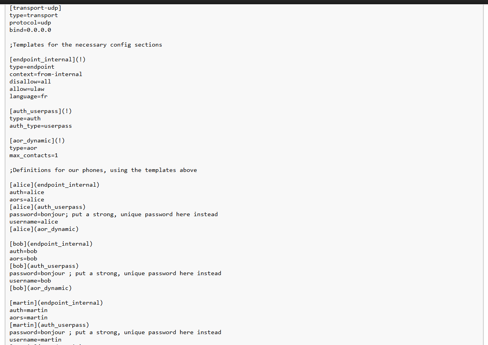<br><em>Figure 16 — Configuration de pjsip.conf</em></p>

#### Plan de numérotation (`extensions.conf`)

| Utilisateur | Numéro |
|---|---|
| Alice | 6001 |
| Bob | 6002 |
| Martin | 6003 |

- Sonnerie de 10 secondes, puis bascule sur le répondeur.
- Numéro du répondeur : **6099**.

<p align="center">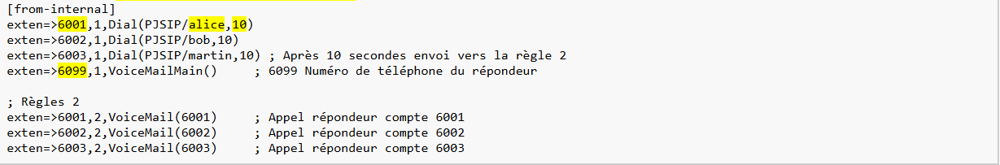<br><em>Figure 17 — Plan de numérotation</em></p>

Après sauvegarde, redémarrer et vérifier le service :

```bash
service asterisk restart
netstat -anup        # vérifie que le port 5060 (SIP) est à l'écoute
service asterisk status
```

## Configuration de la boîte vocale

Le fichier original est sauvegardé :

```bash
mv /etc/asterisk/voicemail.conf /etc/asterisk/voicemail.conf.origin
```

Un nouveau fichier `/etc/asterisk/voicemail.conf` est créé (`nano`) avec le code d'accès par défaut **1234** pour chaque boîte vocale :

```ini
[general]
format=wav49|gsm|wav|ulaw

[default]
; Numéro de messagerie => mot de passe d'accès, nom d'utilisateur
6001 => 1234, Alice
6002 => 1234, bob
6003 => 1234, martin
```

## Tests et validation

### Préparation de l'environnement de test

Une seconde machine virtuelle (Windows 10) est créée dans le **même réseau** que le serveur Asterisk, afin d'y installer des softphones :

- **3CX VoIP** — `https://www.3cx.fr/voip-telephone/`
- **SoftphonePro** — `https://softphone.pro/en/help/download`
- **MicroSIP** — via Softonic

<p align="center">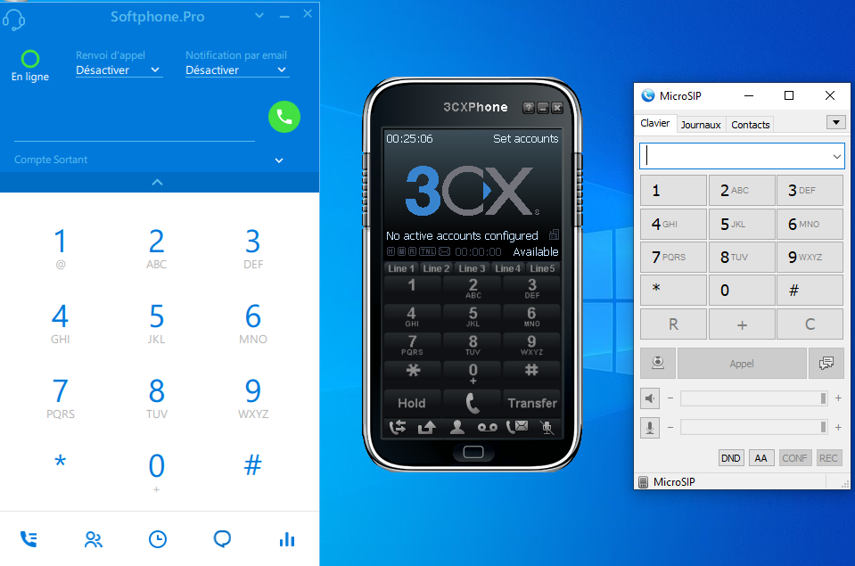<br><em>Figure 18 — Interface du softphone MicroSIP</em></p>

### Vérification de la connectivité réseau

L'adresse IP du serveur Asterisk est récupérée via `ip addr` (ici `192.168.1.70`) :

<p align="center">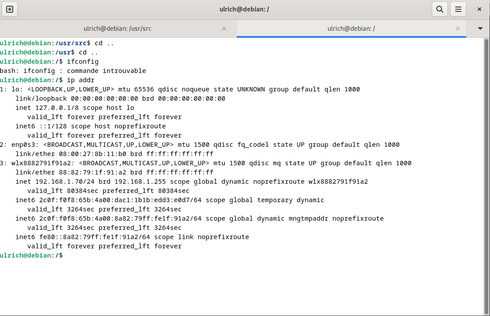<br><em>Figure 19 — Vérification de la communication (adresse IP du serveur)</em></p>

Un test `ping` depuis la machine Windows confirme la connectivité :

```bash
ping 192.168.1.70
```

<p align="center">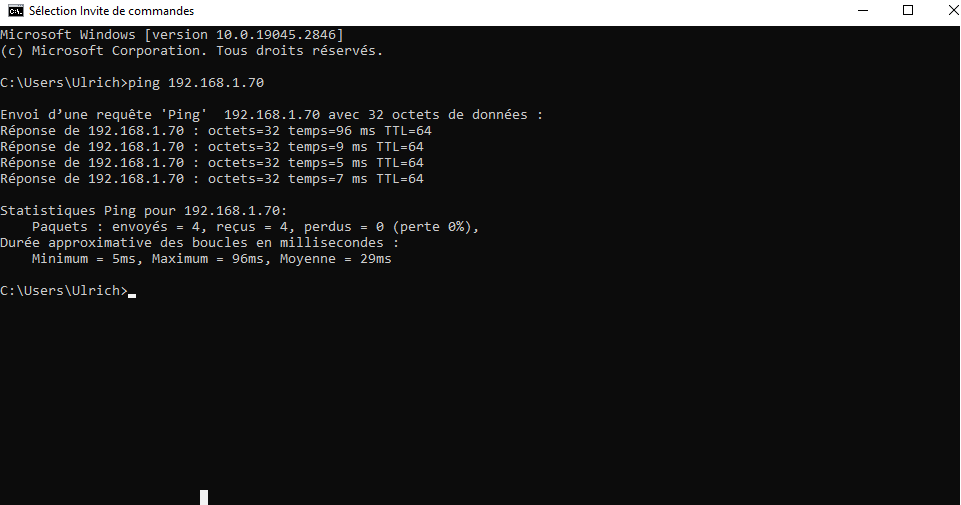<br><em>Figure 20 — Test ping réussi</em></p>

> Après redémarrage, l'adresse IP du serveur change (`192.168.1.69`) ; cette nouvelle adresse est utilisée pour la suite des tests.

### Configuration des softphones

Les comptes définis dans `pjsip.conf` sont déclarés sur deux softphones de test.

**Softphone 3CX (compte Alice) :**

<p align="center">
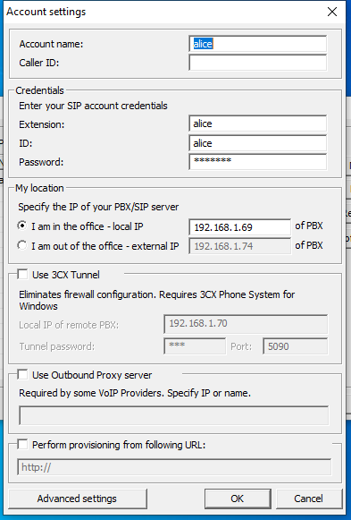

<br><em>Figure 21 — Configuration du softphone 3CX</em>
</p>

Le statut **On Hook** confirme que le téléphone est bien connecté au serveur. Côté serveur, le terminal Asterisk confirme qu'**Alice is now Reachable** :

<p align="center">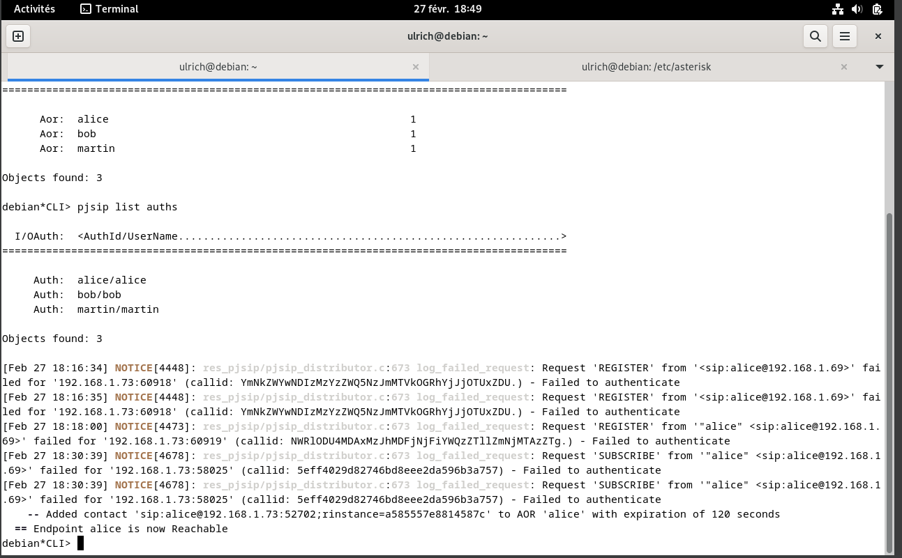<br><em>Figure 22 — Vérification de la connexion du softphone Alice</em></p>

**Softphone MicroSIP (compte Bob, mot de passe « bonjour ») :**

<p align="center">
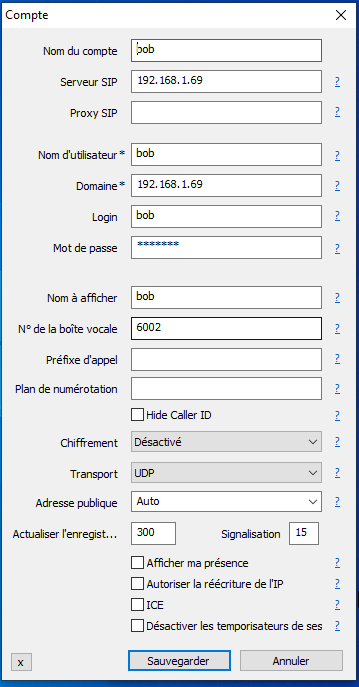
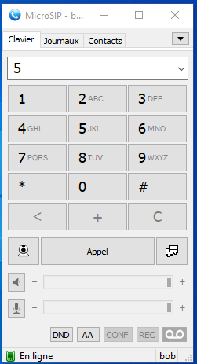
<br><em>Figure 23 — Configuration du softphone MicroSIP (Bob)</em>
</p>

Le statut **En ligne** (en bas à gauche) confirme la connexion. Côté serveur, le terminal confirme que **bob is now Reachable** :

<p align="center">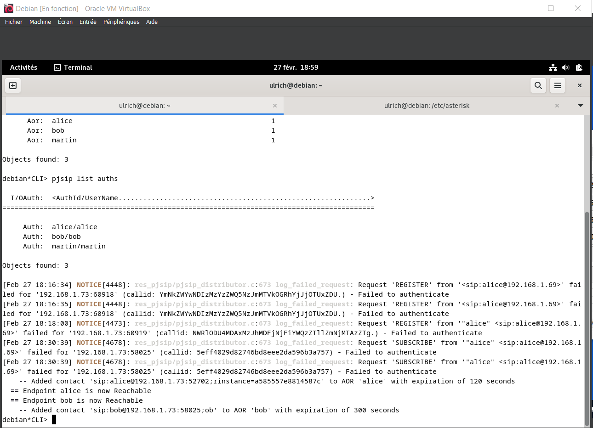<br><em>Figure 24 — Vérification de la connexion du softphone Bob</em></p>

### Test d'appel

Un appel est passé du téléphone d'Alice vers le numéro de Bob :

<p align="center">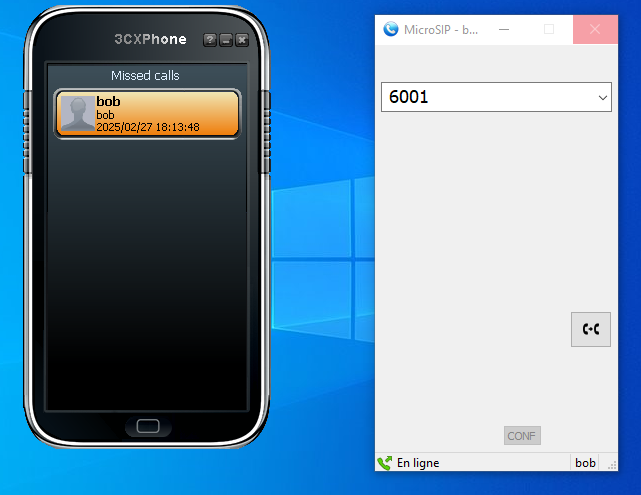<br><em>Figure 25 — Appel test entre Alice et Bob</em></p>

Dans le terminal Asterisk, les journaux confirment que l'appel s'est correctement déroulé, mais qu'Alice n'a pas pu répondre — basculement automatique sur le répondeur :

<p align="center">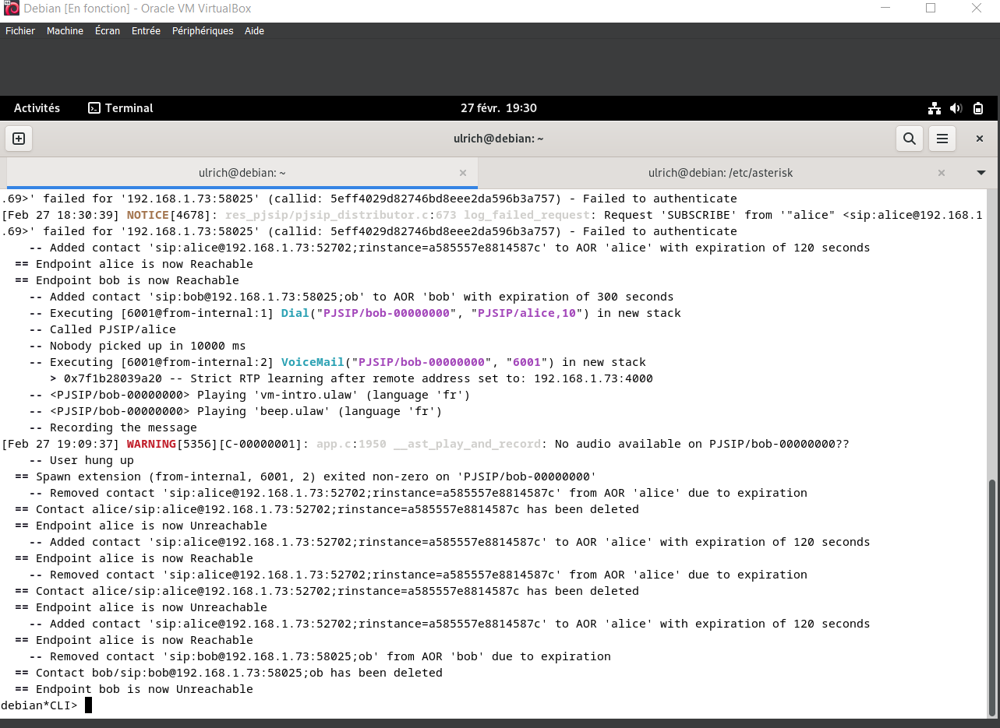<br><em>Figure 26 — Journal de vérification de l'appel (bascule sur répondeur)</em></p>

Ce test conclut la phase de validation du serveur Asterisk.

## Conclusion

La mise en place d'un service de VoIP avec **Asterisk** offre une solution flexible et économique pour les communications d'entreprise. Avec une configuration appropriée, Asterisk répond à une grande variété de besoins en téléphonie, tout en offrant des fonctionnalités avancées telles que la messagerie vocale, les conférences et l'intégration avec d'autres systèmes.

---

*Documentation générée à partir du rapport de projet 2INF1521 — Réseaux Mobiles.*
